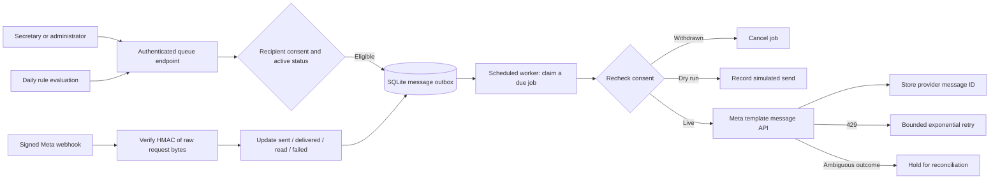

# Individual WhatsApp notification architecture

The included Meta adapter follows the official [template message API](https://whatsapp.github.io/WhatsApp-Nodejs-SDK/api-reference/messages/template/) and [webhook verification model](https://whatsapp.github.io/WhatsApp-Nodejs-SDK/api-reference/webhooks/start/). Consult [Meta's Cloud API collection](https://www.postman.com/meta/whatsapp-business-platform/overview) when selecting an API version and provisioning a business account. These sources describe API contracts; no live business account was configured here.



## Database design

SQLite enables WAL and foreign keys. Connections are closed after each transaction. Operational entities use typed, validated JSON bodies in a `records` table; attendance, sessions, accounts and notification state use relational tables. This choice keeps installation dependency-free while preserving transactional behavior. Future large deployments can migrate each record type to a dedicated SQL table and use a managed database.

| Table | Key data and guarantees |
|---|---|
| users | Unique email, active flag, role, PBKDF2 password hash |
| sessions | SHA256 of random session token, account foreign key, CSRF token, expiry |
| records | Module, validated JSON entity, version for optimistic concurrency; class/member/lesson/offering/event/outreach records |
| attendance | Unique class/member/day, status, study, notes, marker account, update timestamp; all entries in a batch share a transaction |
| messages | Member FK, template, language, ordered body parameters, unique dedupe key, status, attempts, next-attempt time, provider ID, sanitized error, timestamps |
| rules | Name, trigger, template, language, ordered parameters, enabled flag |
| audit | Actor, action, JSON detail, UTC timestamp; offering edits include before/after data |
| login_attempts | Hashed address/email key, bounded attempt count, expiry |

Member JSON includes an international `phone`, `whatsapp_opt_in`, and `consent_at` timestamp. Turning consent off clears the current consent timestamp and prevents queued sends. The application records the staff assertion of consent; collecting consent evidence, retention policy and opt-out intake is a church operational responsibility. Inbound WhatsApp replies and automated STOP handling are not implemented; staff must process opt-out requests promptly in the member record.

## Manual notification workflow

1. Staff verify the member's consent and record it in Members.
2. Staff choose individual consenting recipients, an approved template name and language, and ordered body parameters. `{name}` is replaced per recipient.
3. `/api/notifications/queue` checks role and CSRF, validates the template specification, and inserts one job per eligible member. A request ID plus member ID prevents duplicate retries of the same queue request. Ineligible members are counted as skipped.
4. A worker claims one due job using an immediate SQLite transaction. Other workers cannot claim that same job. Recipient eligibility is rechecked before sending.
5. Dry-run records `dry_run` without contacting Meta. Live mode sends a template to `/{phone-number-id}/messages` and stores the returned ID with status `accepted`.
6. Signed webhooks progress the log to `sent`, `delivered`, or `read`. A late lower-status webhook never downgrades a higher delivery status.

The UI shows the latest 200 jobs; the database retains the rest. Queued jobs can be cancelled. Failed jobs can be reviewed and retried. Uncertain jobs require staff confirmation that Meta did **not** send the message before retrying; that assertion is audited. Retry is an operational tool, not an automatic guarantee of exactly-once external delivery.

## Automation

Create rules in the WhatsApp screen:

- `weekly`: evaluated on Friday UTC for Sabbath preparation.
- `birthday`: matches month/day of a member's stored birthday on the run date.
- `absence`: matches an explicitly marked Absent entry for that run date. Unmarked and excused members do not get absence messages.

Rules support `{name}` and `{date}`. Dedupe keys use rule ID, UTC date and member ID, so a minute-by-minute worker does not requeue the same rule repeatedly. Each rule evaluates current data; there is no missed-day catch-up. Late absence entries added the following day do not automatically trigger a previous-day rule. No church-timezone setting or holiday calendar is included. Edit a rule by removing it and creating a new one; a new rule has a new dedupe identity.

The app includes a worker command, not an installed scheduler:

```sh
python server.py --worker
```

Run it every minute using cron, a service timer, or Windows Task Scheduler, from the app directory with exactly the same database and Meta environment as the web server. One invocation evaluates today's rules and processes up to 100 due messages, then exits. A single supervised worker is recommended. Set a scheduler execution timeout longer than provider requests, and log exit status without credentials. Schedule failure needs your monitoring system; this app does not send its own failure alerts.

Cron example (use absolute paths and export variables securely in the service environment):

```cron
* * * * * cd /srv/ssms-app && /usr/bin/python3 server.py --worker >> /var/log/ssms-worker.log 2>&1
```

For Windows Task Scheduler, choose your Python executable as Program, `server.py --worker` as Arguments, and the extracted app folder as Start in. Repeat every minute, prevent overlapping task instances, and make environment secrets available to the service account. Do not put the access token in command-line arguments.

## Live Meta configuration

Set these variables on the **server and worker**:

| Variable | Required value |
|---|---|
| WHATSAPP_MODE | `live` to enable external requests; absent/default is `dry_run` |
| META_ACCESS_TOKEN | Token authorized to send messages for your WhatsApp business phone number |
| META_PHONE_NUMBER_ID | Meta's phone-number ID, not the human-readable phone number |
| META_GRAPH_VERSION | Supported Graph version selected from Meta documentation, such as `vXX.X` |
| META_APP_SECRET | Application secret used to validate webhook HMAC signatures |
| META_VERIFY_TOKEN | A random token you choose and also enter in the Meta webhook setup |

1. Provision a WhatsApp Business Account and Cloud API phone number through Meta; set up business verification and billing where required by your account.
2. Obtain a server-side token with the necessary messaging permissions, and store it using your deployment secret manager.
3. Submit the reminder, birthday and absence templates for approval. Enter their exact approved names, language and parameter order in this app. There is no template provisioning or approval synchronization endpoint here.
4. Expose `https://your-domain/webhooks/whatsapp` through your HTTPS reverse proxy and subscribe the Meta app to message webhook events for the account.
5. Meta's GET challenge is accepted only when the configured verify token matches. POST requests require a valid `X-Hub-Signature-256` HMAC-SHA256 over the **raw** body with the app secret. Preserve raw bodies and the signature header through your proxy.
6. Send to a consenting test recipient, inspect the provider ID and delivery webhook, and then activate the scheduler. Costs and provider limits are governed by your Meta account.

UI configuration indicators disclose only mode and whether required values are present; tokens and app secrets are never returned to the browser.

## Delivery failures and limits

- HTTP 429 retries at bounded exponential delays: attempts are capped at five automatic tries. The adapter does not parse provider-specific Retry-After headers.
- Missing credentials and ordinary non-rate-limit 4xx errors fail the job, requiring staff correction before retry.
- Timeouts, network errors, malformed responses and 5xx errors become `uncertain` because acceptance may have occurred. No automatic resend follows an ambiguous outcome.
- A job still marked `sending` after five minutes is held as `uncertain` by a later worker invocation.
- Signed delivery events are persisted, including events arriving before the send response. Saving a provider ID replays buffered statuses without downgrading delivered/read. Events are retained up to 30 days and pruned by the worker. Manual reconciliation is still needed for ambiguous sends without a provider ID.
- External delivery is not exactly once: only local job creation/claiming is deduplicated. Provider reconciliation remains necessary after ambiguous results.
- No real token, account permissions, template approval, provider charges, webhook reachability, or live delivery were verified in this build.

The supported template scope is text body parameters. Media headers, URL/button parameters, inbound chat, session messages, opt-out bots, per-tenant credentials and campaign throttling need additional implementation.

The dashboard process button handles up to three jobs per request; the scheduled worker handles up to 100. Production requests require the configured Origin; webhooks instead authenticate their raw-body signature. The included systemd timer runs one worker at a time approximately once per minute. Rules use UTC dates.
